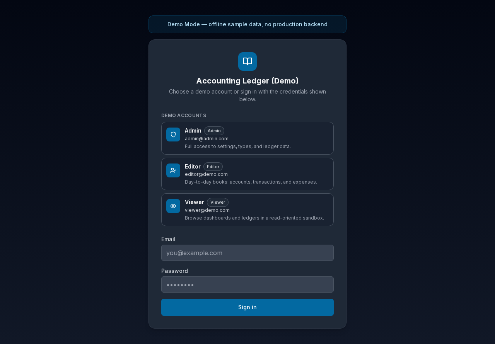

# Login

**Version:** 1.6.0  
**Route:** `/login`  
**Who can access:** Anyone signed out. Production users can sign in or create a new account. Guests can open **Try Demo Mode**.

## Screenshot

## What this page does

Signs you into Accounting Ledger, creates a new private ledger for your business, or starts **Try Demo Mode** with sample books stored only in this browser.

In **production**, each login owns its own data: accounts, transactions, settings, and business name are not shared with other users.

**Try Demo Mode** does not call Supabase mutations — see [18 — Embedded Demo Mode](./18-embedded-demo-mode.md).

## Layout at a glance

- Product icon and heading: **Sign in** or **Create account** (info icon explains privacy)
- Form fields: **Email**, **Password** (and on signup: **Business name**, **Confirm password**)
- Primary action: **Sign in** or **Create account**
- Divider **or**
- Secondary action: **Try Demo Mode** (browser-only sample ledger)
- Toggle link: **Create an account** / **Sign in**

## Steps

### Sign in (production)

1. Open `/login`.
2. Enter **Email** and **Password**.
3. Select **Sign in**.
4. The app opens your private dashboard (or the `next` path when provided).

### Create account (production)

1. On `/login`, select **Create an account**.
2. Enter **Business name**, **Email**, **Password**, and **Confirm password** (min 6 characters).
3. Select **Create account**.
4. If email confirmation is required, check your inbox, then sign in — your ledger is bootstrapped on first session.
5. If the session starts immediately, you land on the dashboard with default account/cash types and your business name.

### Try Demo Mode

1. Open `/login` while signed out.
2. Select **Try Demo Mode** (no credentials).
3. The dashboard opens with Northline Advisory sample data; a banner offers **Exit Demo Mode**.
4. Edits stay in this browser only. Exit returns to `/login`.

## Fields

| Field | Required | Notes |
|-------|----------|--------|
| Business name | Signup only | Stored on the user and applied to ledger settings |
| Email | Yes (auth) | Used for Supabase Auth |
| Password | Yes (auth) | Min 6 characters on signup |
| Confirm password | Signup only | Must match password |

## Related

- [18 — Embedded Demo Mode](./18-embedded-demo-mode.md)
- [02 — Dashboard](./02-dashboard.md)
- [13 — Profile](./13-settings-profile.md)
