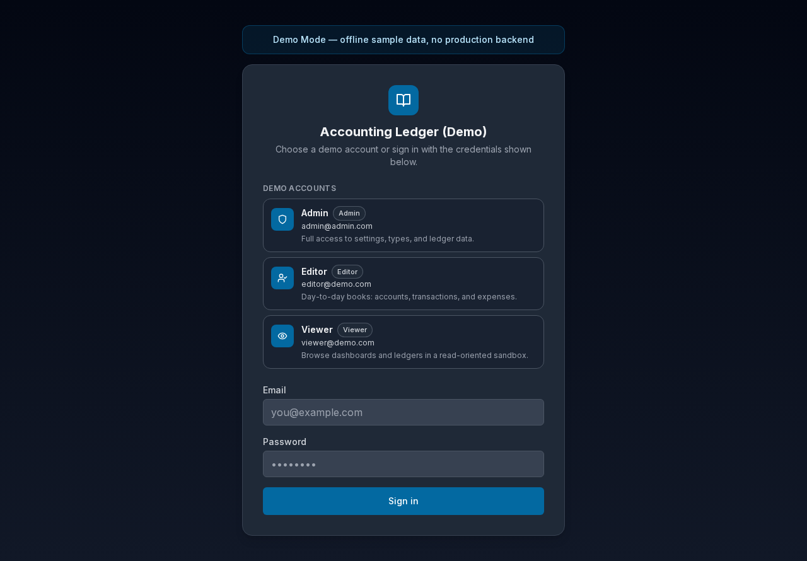

# Login

**Version:** 1.0.0  
**Route:** `/login`  
**Who can access:** Anyone visiting Demo Mode (signed-out users). Production uses credentials provided by your administrator.

## Screenshot

## What this page does

Signs you into Accounting Ledger. In Demo Mode, sample books are stored in this browser only — there is no production backend. Choose a demo account card for the fastest start, or enter email and password manually.

## Layout at a glance

- Banner: **Demo Mode — offline sample data, no production backend**
- Product title: **Accounting Ledger (Demo)**
- **DEMO ACCOUNTS** — clickable cards for Admin, Editor, and Viewer
- Form fields: **Email**, **Password**
- Primary action: **Sign in**

## Steps

### Sign in with a demo account card

1. Open the Demo Mode app (from the project page when deployed, or locally).
2. On the login screen, find **DEMO ACCOUNTS**.
3. Select a card:
   - **Admin** — full access to settings, types, and ledger data
   - **Editor** — day-to-day books: accounts, transactions, and expenses
   - **Viewer** — browse dashboards and ledgers in a read-oriented sandbox
4. The app signs you in and opens the [Dashboard](./02-dashboard.md).

Demo logins appear as account cards on the Demo Mode login screen (email is shown on each card). Do not copy passwords into external documents.

### Sign in with email and password

1. Enter **Email** (placeholder: `you@example.com`).
2. Enter **Password**.
3. Select **Sign in**.
4. While the request runs, the button shows **Signing in…**.

## Fields

| Field | Required | Notes |
|-------|----------|--------|
| Email | Yes | Must match a demo account when using Demo Mode |
| Password | Yes | Shown on the account cards in Demo Mode only |

## Errors & edge cases

- Empty email or password: **Email and password are required.**
- Wrong credentials: a clear error message appears above the form (for example, sign-in failed). Correct the values or use an account card.
- Already signed in: visiting a protected page redirects you to the app; signing out returns you here.
- Demo data is per browser and per demo user — clearing site data resets local sandboxes.

## Related links

- [Getting started](./00-getting-started.md)
- [Dashboard](./02-dashboard.md)
- [Mobile](./16-mobile.md)
