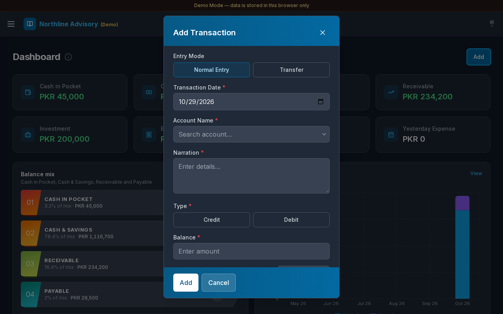

# Dashboard

**Version:** 1.0.0  
**Route:** `/`  
**Who can access:** Signed-in users (Admin, Editor, Viewer in Demo Mode).

## Screenshots

## What this page does

Gives a single overview of your books: key balances, expense snapshots, balance mix, and monthly expense charts. You can also open **Add Transaction** without leaving the dashboard.

## Layout at a glance

- Page title **Dashboard** with an info tip (**About Dashboard**)
- **Add** button (desktop) or **Add Transaction** icon (mobile)
- KPI cards: **Cash in Pocket**, **Cash & Savings**, **Payable**, **Receivable**, **Investment**, **Expenses**, **Today Expense**, **Yesterday Expense**
- **Balance Mix** ribbons
- **Monthly expenses** chart (last 6 months) with a **View** link where available
- Demo banner: **Demo Mode — data is stored in this browser only.**

## Steps

### Review balances

1. After [login](./01-login.md), you land on **Dashboard**.
2. Read the KPI cards. Positive amounts appear in green; negative amounts in red where applicable.
3. Select a linked card (for example **Cash & Savings**, **Payable**, **Receivable**, **Investment**, **Expenses**) to open that page.
4. Select **Today Expense** or **Yesterday Expense** to open [Transactions](./03-transactions.md) filtered to that date.

### Add a transaction from the dashboard

1. Select **Add** (or the plus control on mobile).
2. The **Add Transaction** modal opens.
3. Choose **Entry Mode**: **Normal Entry** or **Transfer**.
4. Set **Transaction Date**.
5. For **Normal Entry**:
   - Choose **Account Name**
   - Enter **Narration**
   - Choose **Credit** or **Debit**
   - Enter **Balance** (amount)
   - Optionally attach files
6. For **Transfer**:
   - Choose **To Account (In)** and **From Account (Out)**
   - Enter **Narration** and **Balance**
7. Select **Add** to save, or **Cancel** to close without saving.
8. The dashboard refreshes so KPIs and charts reflect the new entry.

### Use the info tip

1. Select the info icon next to **Dashboard**.
2. Read: *Overview of your books — balances, ledgers, and recent activity.*
3. Click outside the tip to close it.

## KPI cards

| Card | Meaning |
|------|---------|
| Cash in Pocket | Pocket / cash-in-hand style accounts |
| Cash & Savings | Accounts matching Settings → Cash & Savings filters |
| Payable | Matching payable accounts with negative balance |
| Receivable | Matching receivable accounts with positive balance |
| Investment | Accounts typed as Invest / Investment |
| Expenses | Expense-type account balances |
| Today Expense | Spend posted for today |
| Yesterday Expense | Spend posted for yesterday |

## Add Transaction modal fields

| Field | Required | Notes |
|-------|----------|--------|
| Entry Mode | Yes | **Normal Entry** or **Transfer** |
| Transaction Date | Yes | Defaults to today |
| Account Name | Normal mode | Searchable account list |
| To Account (In) / From Account (Out) | Transfer mode | Must be different accounts |
| Narration | Yes | Short description |
| Credit / Debit | Normal mode | Entry type |
| Balance | Yes | Amount (non-negative number) |
| Attachments | No | Optional supporting files |

## Errors & edge cases

- Missing date, narration, account, type, or amount: the modal shows a calm validation message (for example **Narration is required.** or **Balance is required.**).
- Transfer with the same From and To account: **From and To accounts must be different.**
- No accounts yet: the form notes that accounts must be added under **Accounts** first.
- Charts may load slightly after the KPI cards; wait a moment if the chart area still shows a placeholder.

## Related links

- [Login](./01-login.md)
- [Transactions](./03-transactions.md)
- [Cash & Savings](./05-cash-savings.md)
- [Expenses](./08-expenses.md)
- [Mobile](./16-mobile.md)
