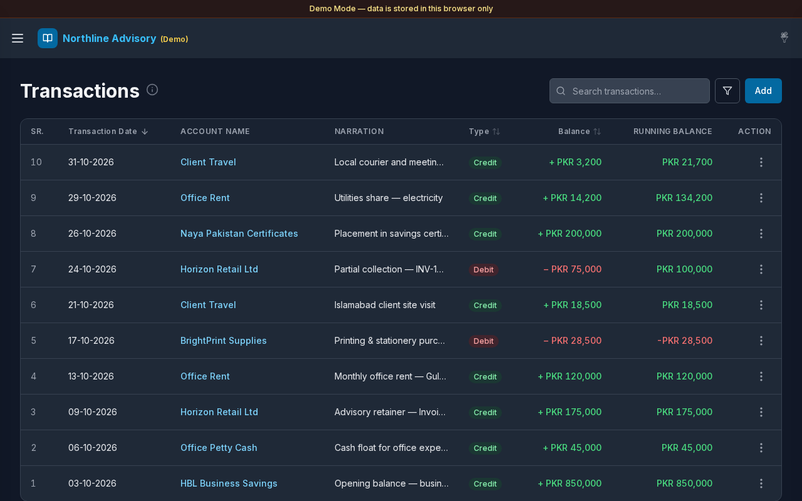
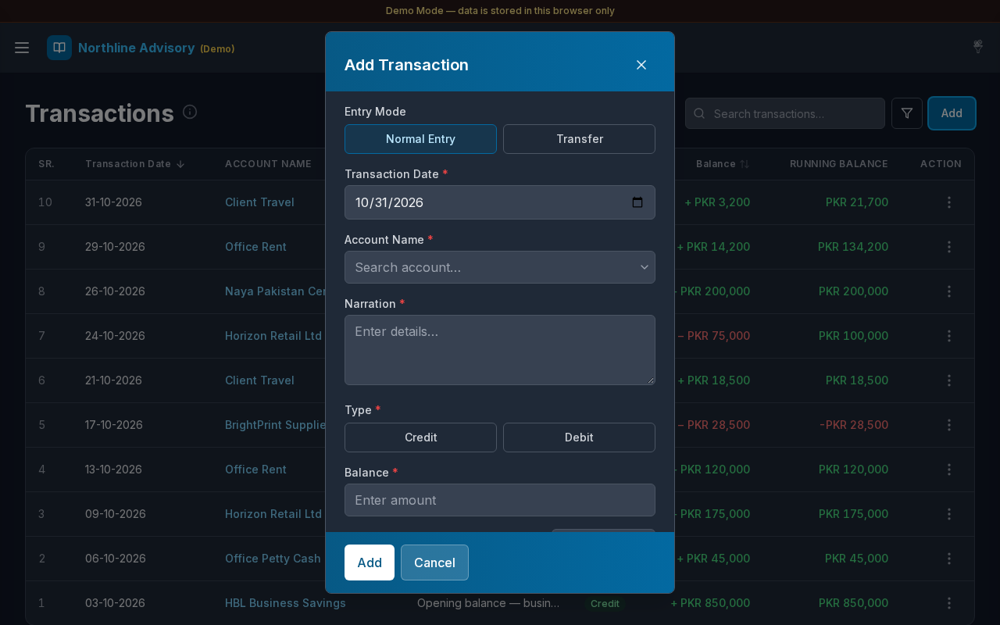

# Transactions

**Version:** 1.0.3  
**Route:** `/transactions`  
**Who can access:** Signed-in users. Editors and Admins can add and edit; Viewers primarily browse.

## Screenshots

## What this page does

The journal of every debit, credit, and transfer. Search and filter entries, sort key columns, open a transaction preview (Details / Documents), add or edit transactions, attach documents, export a voucher PDF, and send a WhatsApp message with optional PDF / ledger links.

## Layout at a glance

- Title **Transactions** with info tip
- Search: **Search transactions…**
- Filter control (funnel) for date range, type, and related filters
- **Add** button
- Table columns: **SR.**, **TRANSACTION DATE**, **ACCOUNT NAME**, **NARRATION**, **TYPE**, **BALANCE**, **RUNNING BALANCE**, **ACTION**
- Sortable headers: **Transaction Date**, **Type**, and **Balance** (click to toggle ascending / descending)
- Compact pagination on mobile (first … current … last)
- Optional back link when opened from another page with a return path

## Steps

### Browse the journal

1. Open **Transactions** from the sidebar, the dashboard **Transactions** button, or an account / KPI link.
2. Review rows newest-first by transaction date (or your active sort).
3. **TYPE** shows **Credit** (green) or **Debit** (red).
4. **BALANCE** shows signed amounts; **RUNNING BALANCE** shows the cumulative position for context.

### Sort columns

1. Select **TRANSACTION DATE**, **TYPE**, or **BALANCE** in the table header.
2. Click again to reverse the sort direction.

### Search

1. Enter text in **Search transactions…**.
2. Matching rows filter by account name, narration, and related fields.

### Filter

1. Select the filter (funnel) control.
2. Set date range and type filters as needed (for example Credit or Debit).
3. Apply filters; active filters appear as chips you can clear.
4. Use clear-all when you want the full journal again.

### Add a transaction

1. Select **Add**.
2. In **Add Transaction**, choose **Normal Entry** or **Transfer**.
3. Fill **Transaction Date**, account fields, **Narration**, type (Credit/Debit for normal), and **Balance**.
4. Optionally attach files.
5. Select **Add** (or **Save** when editing), or **Cancel**.
6. The modal closes quickly; uploads finish in the background when attachments are present.

### Open transaction preview

1. Select a row (or **Details** from the row menu).
2. Use the **Details** and **Documents** tabs. Documents shows a file count badge when attachments exist.
3. Footer icon buttons: **Send message**, **Edit**, and **Close**.

### Send message / export PDF

1. From the row menu or preview footer, choose **Send message** (opens WhatsApp promptly while PDFs build).
2. When Allow URL is on in Settings, the message fills **`{{pdf_url}}`** (voucher) and/or **`{{ledger_url}}`** (account ledger) with short public links.
3. **Export PDF** builds a voucher plus uploaded images (including WebP/GIF) without duplicating a previously saved voucher file already in Documents.

### Row actions

1. Open the **ACTION** menu (⋯) on a row.
2. Typical options include **Details**, **Edit**, **Delete**, **Send message**, and PDF export when available.
3. Confirm deletes in the **Delete** dialog.

### Open an account ledger

1. Select an **ACCOUNT NAME** link.
2. Or arrive from Cash & Savings / Payable / Receivable / Expenses with `accountId` already set — a filter chip shows the account.
3. Use the back control when a return path was provided.

## Table columns

| Column | Description |
|--------|-------------|
| SR. | Row number on the current page |
| TRANSACTION DATE | Display date (DD-MM-YYYY); sortable |
| ACCOUNT NAME | Linked account |
| NARRATION | Description |
| TYPE | Credit or Debit badge; sortable |
| BALANCE | Signed amount in the default currency; sortable |
| RUNNING BALANCE | Cumulative balance context |
| ACTION | Row menu |

## Errors & edge cases

- Validation in the modal mirrors the dashboard form (required date, narration, amount, accounts).
- Delete asks for confirmation before removing an entry.
- Empty search or filters: a calm empty state explains that nothing matches.
- Date filters from **Today Expense** / **Yesterday Expense** on the dashboard pre-fill the journal for **expense accounts only**.
- On mobile, the back-to-top control sits above pagination so it does not cover page controls.

## Related links

- [Dashboard](./02-dashboard.md)
- [Accounts](./04-accounts.md)
- [Settings](./12-settings.md) (message templates and Allow URL)
