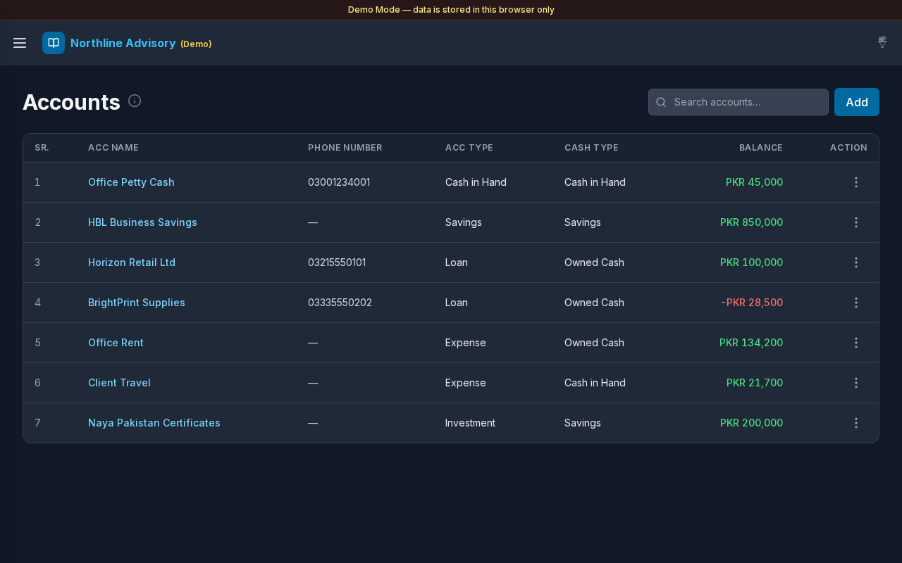
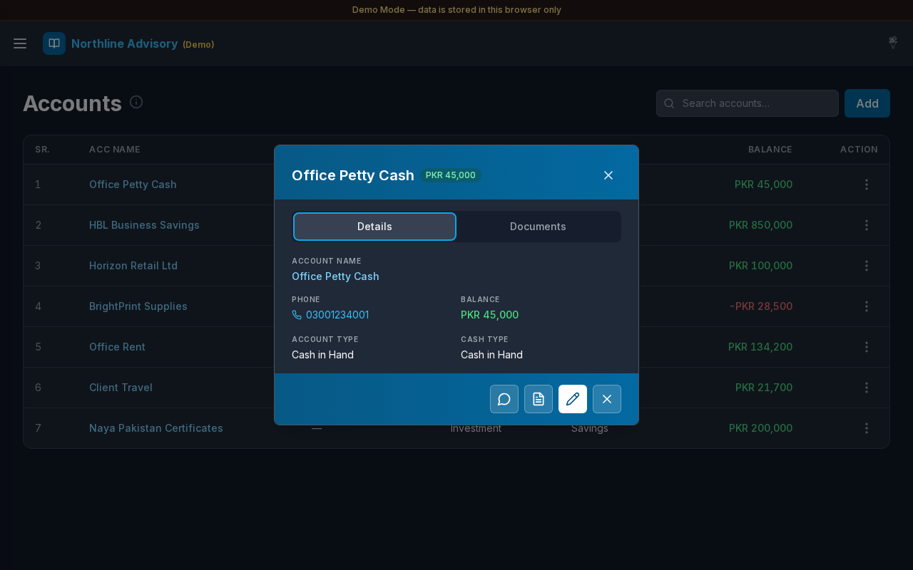

# Accounts

**Version:** 1.2.3  
**Route:** `/accounts`  
**Add:** `/accounts/new`  
**Edit:** `/accounts/{id}/edit`  
**Detail:** `/accounts/{id}`  
**Who can access:** Signed-in users. Admins and Editors manage accounts; Viewers can browse.

## Screenshots

## What this page does

Master list of ledger accounts (parties, cash wallets, expense heads, investments, and more). Create and edit accounts, assign **Account Type** and **Cash Type**, search the list, open **Account Details** (Details / Documents), export a ledger PDF, and send a WhatsApp message with an optional ledger link.

## Layout at a glance

- Title **Accounts** with info tip
- Search: **Search accounts…**
- **Add** button → full **Add Account** page
- Table: **SR.**, **ACC Name**, **Phone Number**, **ACC Type**, **Cash Type**, **Balance**, actions
- Pagination when the list exceeds the page size (compact on mobile)
- Modals: **Export ledger**, **Delete Account?** (add/edit are full pages)

## Steps

### Browse accounts

1. Open **Accounts** from the sidebar.
2. Review name, phone, types, and current **Balance**.
3. Select an account name to open [Transactions](./03-transactions.md) filtered to that account.

### Search

1. Type in **Search accounts…**.
2. Results match name, phone, types, and balance text.

### Open Account Details

1. Select a row, or open **Actions** → **Details**.
2. Account opens at **`/accounts/{id}`** (Details + Documents stacked).
3. Use floating **Actions** for Send message, Edit, and Delete; **Save ledger PDF** sits beside Upload on Documents.
4. **Save ledger PDF** generates the account ledger PDF into that account’s Documents.

### Add an account

1. Select **Add**.
2. On **`/accounts/new`**, fill:
   - **ACC Name** (required)
   - **Phone Number** (optional)
   - **Account Type**
   - **Cash Type**
3. Select **Add** to save (opens the new account), or **Cancel** to return to the list.

### Edit an account

1. Open the row **Actions** menu, or Edit from account detail.
2. The **Edit Account** page opens at **`/accounts/{id}/edit`**.
3. Update fields and select **Save**.

### Export a ledger

1. Open **Actions** for an account.
2. Choose **Export ledger**.
3. Pick a format and select **Download**.

### Send message

1. Open **Actions** → **Send message**, or use the preview footer icon.
2. WhatsApp opens promptly. When Allow URL is on in Settings, **`{{ledger_url}}`** is filled with a short public link to the ledger PDF.

### Delete an account

1. Open **Actions** → **Delete**.
2. Confirm in **Delete Account?**
3. Select **Delete** to remove, or **Cancel** to keep the account.

## Fields (Add / Edit Account)

| Field | Required | Notes |
|-------|----------|--------|
| ACC Name | Yes | Display name on journals and lists |
| Phone Number | No | Used for call / message shortcuts |
| Account Type | Recommended | From Settings → Account Type |
| Cash Type | Recommended | From Settings → Cash Type |

If no active types exist, the form points you to **Settings → Account Type** or **Settings → Cash Type**.

## Errors & edge cases

- Missing name: **Account name is required.**
- Empty list: **No accounts yet. Click Add to create one.**
- No search matches: a calm empty message appears.
- Balances update from posted transactions; opening balances may appear as early journal lines.
- If Allow URL is off or the share link cannot be built, Send message still opens WhatsApp with the template text.

## Related links

- [Transactions](./03-transactions.md)
- [Account Type](./14-settings-account-type.md)
- [Cash Type](./15-settings-cash-type.md)
- [Settings](./12-settings.md) (message templates)
- [Cash & Savings](./05-cash-savings.md)
