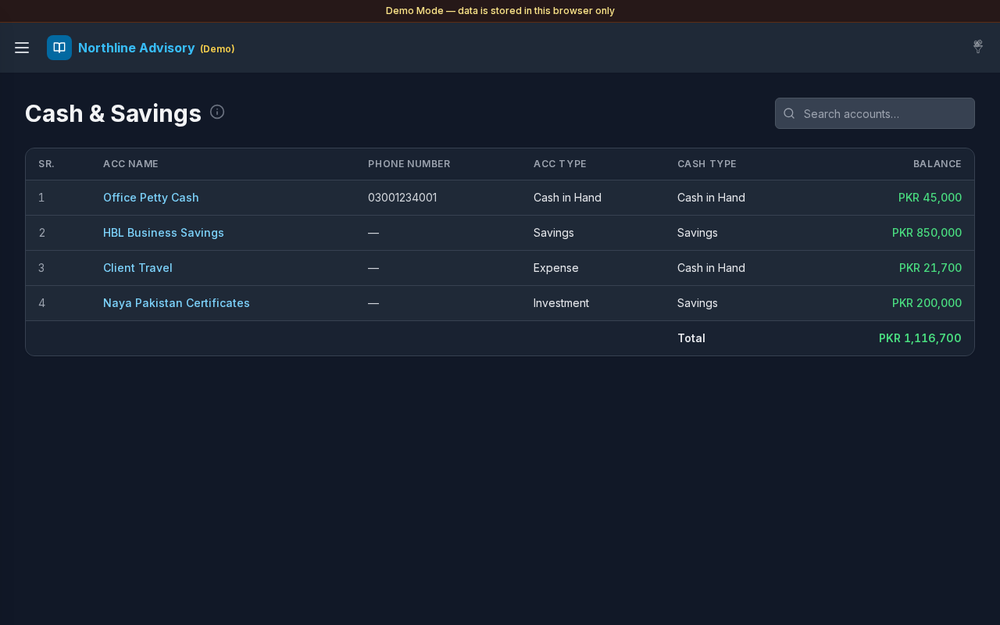

# Cash & Savings

**Version:** 1.0.0  
**Route:** `/cash-savings`  
**Who can access:** Signed-in users.

## Screenshot

## What this page does

Lists accounts that match the **Cash & Savings** filters configured under Settings (selected **Account Type** and/or **Cash Type** values). Use it to monitor liquid balances and jump into each account’s journal.

## Layout at a glance

- Title **Cash & Savings** with info tip
- Search: **Search accounts…**
- Table: **SR.**, **ACC Name**, **Phone Number**, **ACC Type**, **Cash Type**, **Balance**
- Footer **Total** of listed balances
- Pagination when needed

## Steps

### Review cash positions

1. Open **Cash & Savings** from the sidebar (or the Dashboard KPI card).
2. Read each account’s **Balance** (green for positive, red for negative).
3. Check the **Total** row for the filtered set.

### Search

1. Enter text in **Search accounts…**.
2. Narrow by name, phone, type, or balance text.

### Open an account journal

1. Select an **ACC Name** link.
2. [Transactions](./03-transactions.md) opens filtered to that account, with a path back to Cash & Savings.

### Adjust which accounts appear

1. Open [Settings](./12-settings.md).
2. Under **Cash & Savings**, set **Account Type** and **Cash Type** multi-selects.
3. Select **Save**.
4. Return here — the list refreshes to matching accounts.

## Table columns

| Column | Description |
|--------|-------------|
| SR. | Row number |
| ACC Name | Linked account |
| Phone Number | Contact if set |
| ACC Type | Account type label |
| Cash Type | Cash type label |
| Balance | Current balance in default currency |

## Errors & edge cases

- Empty list: **No matching Cash & Savings accounts yet.** Confirm Settings filters and that accounts use those types.
- No search matches: **No accounts match your search.**
- Info tip: accounts matching any selected Account Type or Cash Type under **Settings → Cash & Savings**.

## Related links

- [Dashboard](./02-dashboard.md)
- [Accounts](./04-accounts.md)
- [Settings](./12-settings.md)
