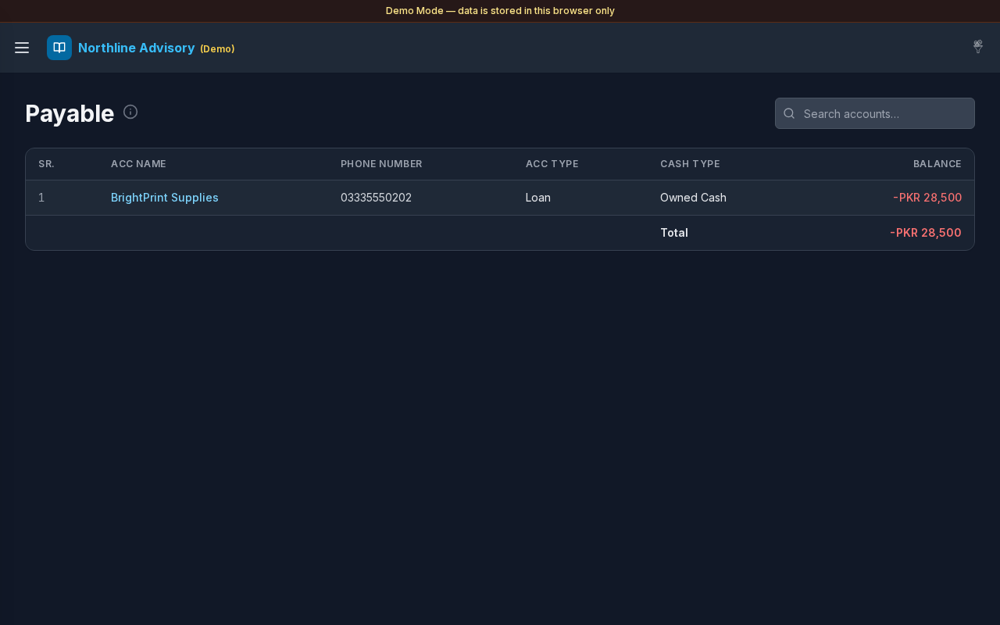

# Payable

**Version:** 1.0.0  
**Route:** `/payable`  
**Who can access:** Signed-in users.

## Screenshot

## What this page does

Shows accounts that match **Settings → Payable & Receivable** filters and currently have a **minus (negative) balance** — amounts you owe.

## Layout at a glance

- Title **Payable** with info tip
- Search: **Search accounts…**
- Same account table layout as Cash & Savings (**SR.**, **ACC Name**, **Phone Number**, **ACC Type**, **Cash Type**, **Balance**)
- **Total** of listed payable balances

## Steps

### Review what you owe

1. Open **Payable** from the sidebar or the Dashboard **Payable** card.
2. Negative balances appear in red.
3. Use **Total** for the filtered payable set.

### Search and open ledgers

1. Filter with **Search accounts…** if needed.
2. Select an **ACC Name** to open that account’s [Transactions](./03-transactions.md).

### Control membership

1. In [Settings](./12-settings.md), under **Payable & Receivable**, choose **Account Type** and **Cash Type**.
2. Select **Save**.
3. Only matching accounts with a negative balance appear here; the same filters with a positive balance appear under [Receivable](./07-receivable.md).

## Errors & edge cases

- Empty list: **No matching Payable accounts yet.** You may have no negative balances, or filters may need updating.
- An account that moves from negative to positive leaves Payable and can appear under Receivable.
- Info tip: accounts matching Settings → Payable & Receivable with a minus (negative) balance.

## Related links

- [Receivable](./07-receivable.md)
- [Accounts](./04-accounts.md)
- [Settings](./12-settings.md)
- [Dashboard](./02-dashboard.md)
