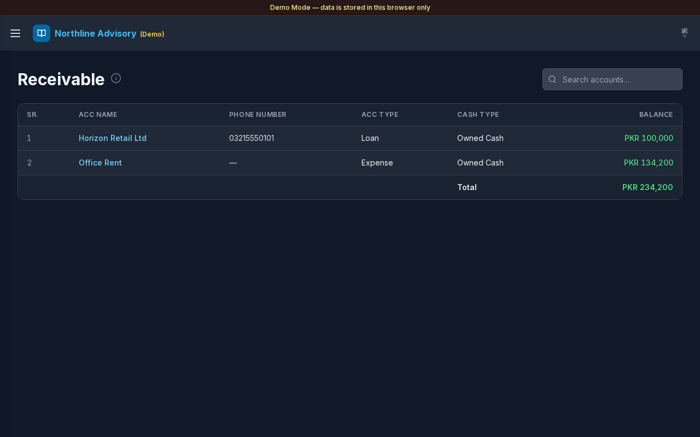

# Receivable

**Version:** 1.0.0  
**Route:** `/receivable`  
**Who can access:** Signed-in users.

## Screenshot

## What this page does

Shows accounts that match **Settings → Payable & Receivable** filters and currently have a **plus (positive) balance** — amounts owed to you.

## Layout at a glance

- Title **Receivable** with info tip
- Search: **Search accounts…**
- Account table: **SR.**, **ACC Name**, **Phone Number**, **ACC Type**, **Cash Type**, **Balance**
- **Total** of listed receivable balances

## Steps

### Review what is owed to you

1. Open **Receivable** from the sidebar or the Dashboard **Receivable** card.
2. Positive balances appear in green.
3. Check **Total** for the filtered set.

### Search and open ledgers

1. Use **Search accounts…** to find a party.
2. Select **ACC Name** to open [Transactions](./03-transactions.md) for that account.

### Align with Payable filters

1. Payable and Receivable share the same type filters under [Settings](./12-settings.md) → **Payable & Receivable**.
2. After **Save**, sign of the balance decides Payable vs Receivable.

## Errors & edge cases

- Empty list: **No matching Receivable accounts yet.**
- Zero-balance accounts in the filter set do not appear on Payable or Receivable.
- Info tip: accounts matching Settings → Payable & Receivable with a plus (positive) balance.

## Related links

- [Payable](./06-payable.md)
- [Accounts](./04-accounts.md)
- [Settings](./12-settings.md)
- [Dashboard](./02-dashboard.md)
