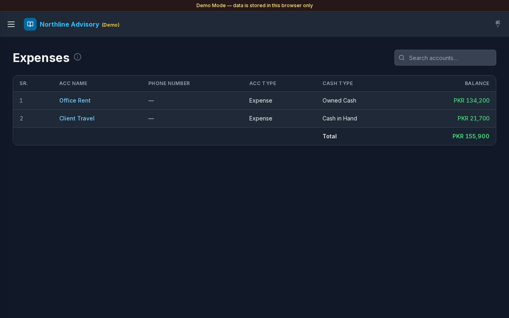

# Expenses

**Version:** 1.0.0  
**Route:** `/expenses`  
**Who can access:** Signed-in users.

## Screenshot

## What this page does

Lists expense accounts (Account Type **Expense** or **Expenses**). From here you can open each expense head’s journal. Day- and month-level spend summaries live on sibling pages under the Expenses menu.

## Layout at a glance

- Title **Expenses** with info tip
- Search: **Search accounts…**
- Account table: **SR.**, **ACC Name**, **Phone Number**, **ACC Type**, **Cash Type**, **Balance**
- **Total** of listed expense account balances
- Sidebar siblings: **Daily Expense**, **Monthly Expense**

## Steps

### Browse expense heads

1. Open **Expenses** → **Expenses** in the sidebar (or the Dashboard **Expenses** card).
2. Review each expense account and its **Balance**.
3. Select an **ACC Name** to open filtered [Transactions](./03-transactions.md).

### Search

1. Use **Search accounts…** to find an expense head by name or type.

### Related expense views

1. Open [Daily Expense](./09-expenses-daily.md) for a day calendar of spend.
2. Open [Monthly Expense](./10-expenses-monthly.md) for year-by-month totals.

## Errors & edge cases

- Empty list: **No Expense accounts yet.** Create accounts with Account Type Expense / Expenses under [Accounts](./04-accounts.md).
- Info tip: accounts with Account Type Expense or Expenses.
- This page lists account balances; daily/monthly pages aggregate transaction spend.

## Related links

- [Daily Expense](./09-expenses-daily.md)
- [Monthly Expense](./10-expenses-monthly.md)
- [Accounts](./04-accounts.md)
- [Dashboard](./02-dashboard.md)
