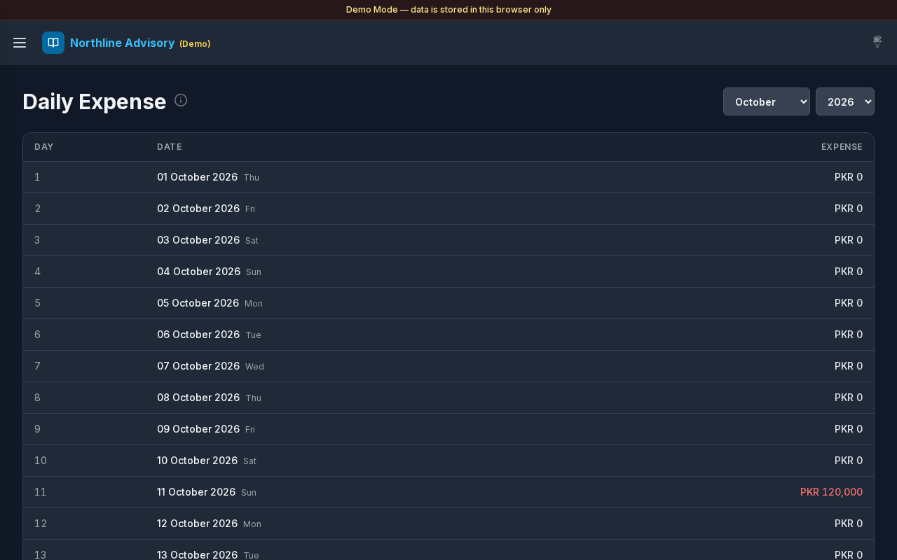

# Daily Expense

**Version:** 1.0.0  
**Route:** `/expenses/daily`  
**Who can access:** Signed-in users.

## Screenshot

## What this page does

Day-wise expense totals for a selected month. Tap or click a day to see which expense accounts contributed. Credit amounts count as spend; debit reverses spend.

## Layout at a glance

- Title **Daily Expense** with info tip
- Month and year selectors
- Desktop table: **Day**, **Date**, **Expense**
- Footer: **Total Month Expenses**
- Day detail modal with account breakdown and **Close**
- Mobile: day cards with weekday labels and a **Today** marker on the current day

## Steps

### Choose a month

1. Open **Expenses** → **Daily Expense**.
2. Select the month (for example **October**) and year from the dropdowns.
3. The day list refreshes for that month.

### Read daily totals

1. Scan the **Expense** column (or amounts on mobile cards).
2. Spend appears in red; reverse amounts in green.
3. Check **Total Month Expenses** at the bottom.

### Inspect a day

1. Select a day row or card.
2. A modal titled with the date (for example `29 October 2026 · Wed`) lists expense accounts and amounts.
3. Select an account name to open [Transactions](./03-transactions.md) for that account (return path: Daily Expense).
4. Review **Total** in the modal, then select **Close**.

## Table columns

| Column | Description |
|--------|-------------|
| Day | Day number in the month |
| Date | Full date with weekday; **Today** on the current day |
| Expense | Net spend for that day |

## Errors & edge cases

- Days with no activity still appear with a zero amount.
- Day modal with no activity: **No expense account activity this day.**
- Load failures show a calm banner (for example failed to load expenses).
- Info tip: day-wise totals; tap a day for expense accounts; credit = spend, debit reverses.

## Related links

- [Expenses](./08-expenses.md)
- [Monthly Expense](./10-expenses-monthly.md)
- [Transactions](./03-transactions.md)
