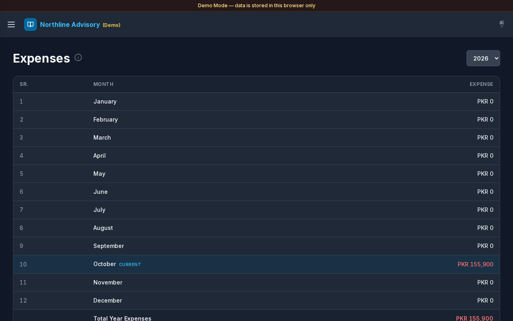

# Monthly Expense

**Version:** 1.0.3  
**Route:** `/expenses/monthly`  
**Who can access:** Signed-in users.

## Screenshot

## What this page does

Year overview of expense spend by calendar month. Select a month to see contributing expense accounts. Credit counts as spend; debit reverses.

## Layout at a glance

- Page heading **Expenses** (monthly view) with info tip
- Year selector
- Desktop table: **SR.**, **Month**, **Expense**
- Footer: **Total Year Expenses**
- Month detail modal with account list, **Total**, and **Close**
- **Current** / **Current month** marker on the active month

## Steps

### Choose a year

1. Open **Expenses** → **Monthly Expense**.
2. Select a year from the dropdown.
3. All twelve months list with totals for that year.

### Read monthly totals

1. Review **Expense** per month.
2. Check **Total Year Expenses**.

### Inspect a month

1. Select a month row (for example **October**).
2. Modal title shows **Month Year** (for example `October 2026`).
3. Select an account to open filtered [Transactions](./03-transactions.md).
4. Select **Close** when finished.

## Table columns

| Column | Description |
|--------|-------------|
| SR. | 1–12 |
| Month | January–December; current month marked |
| Expense | Net spend for that month |

## Errors & edge cases

- Months with no postings show zero.
- Empty month modal: **No expense account activity this month.**
- Info tip: tap a month for expense accounts; credit = spend, debit reverses.

## Related links

- [Expenses](./08-expenses.md)
- [Daily Expense](./09-expenses-daily.md)
- [Dashboard](./02-dashboard.md) (Monthly expenses chart)
