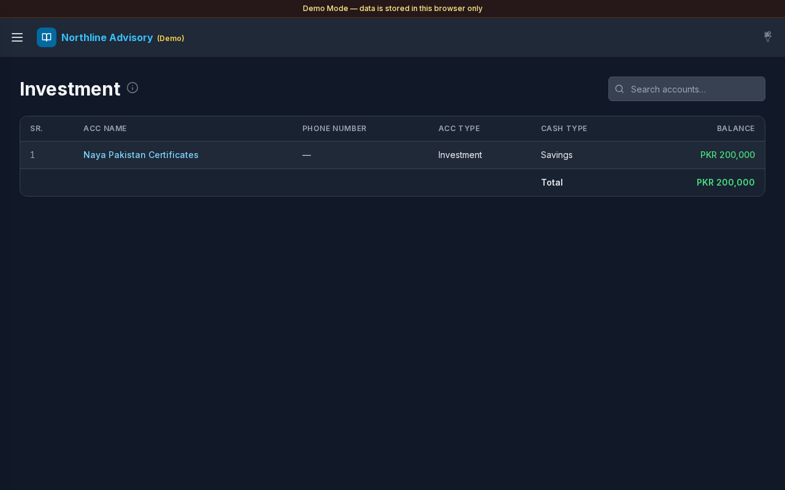

# Investment

**Version:** 1.0.3  
**Route:** `/investment`  
**Who can access:** Signed-in users.

## Screenshot

## What this page does

Lists accounts whose Account Type is **Invest** or **Investment**. Track portfolio-style balances and open each investment account’s journal.

## Layout at a glance

- Title **Investment** with info tip
- Search: **Search accounts…**
- Account table: **SR.**, **ACC Name**, **Phone Number**, **ACC Type**, **Cash Type**, **Balance**
- **Total** of listed investment balances

## Steps

### Review investments

1. Open **Investment** from the sidebar or the Dashboard **Investment** card.
2. Review each account’s **Balance**.
3. Use **Total** for the filtered set.

### Search and open a ledger

1. Use **Search accounts…** if the list is long.
2. Select **ACC Name** to open [Transactions](./03-transactions.md) for that investment.

### Add investment accounts

1. Create or edit accounts under [Accounts](./04-accounts.md).
2. Assign Account Type **Invest** or **Investment** (manage types under [Account Type](./14-settings-account-type.md)).
3. Return here to see them in the list.

## Errors & edge cases

- Empty list: **No Investment accounts yet.**
- Info tip: accounts with Account Type Invest or Investment.
- Classification is by account type name, not by Settings multi-select filters.

## Related links

- [Accounts](./04-accounts.md)
- [Account Type](./14-settings-account-type.md)
- [Dashboard](./02-dashboard.md)
