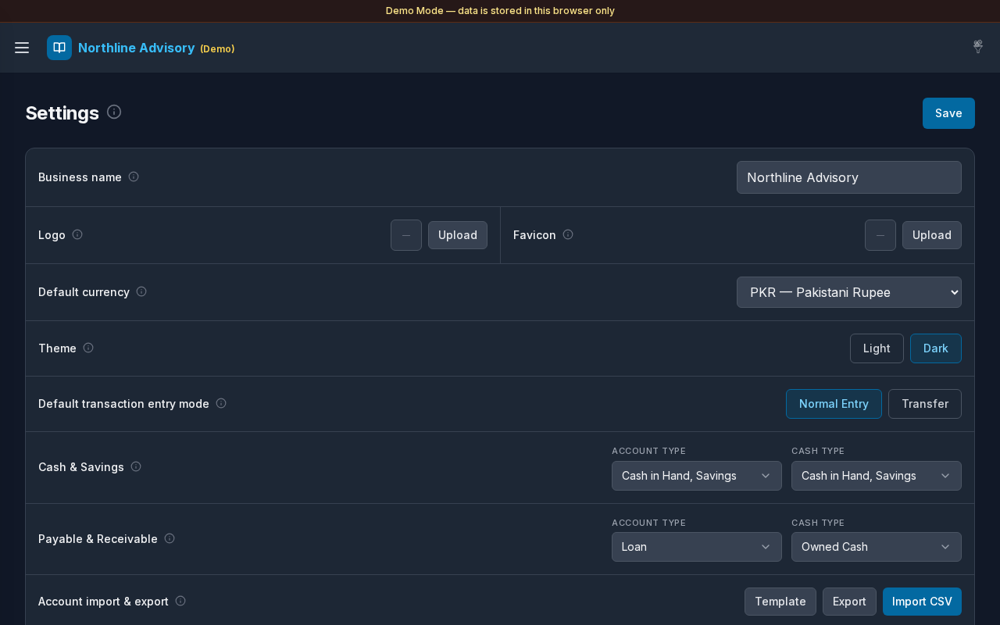

# Settings (General)

**Version:** 1.0.0  
**Route:** `/settings`  
**Who can access:** Signed-in users. Branding and type filters are typically managed by Admin in Demo Mode.

## Screenshot

## What this page does

Business branding, default currency, theme, default transaction entry mode, which types feed Cash & Savings and Payable/Receivable views, and CSV import/export for accounts and transactions. Message templates and related options may appear further down the page when scrolled.

## Layout at a glance

- Title **Settings** with info tip
- Primary action: **Save**
- Rows: **Business name**, **Logo**, **Favicon**, **Default currency**, **Theme**, **Default transaction entry mode**
- Filter groups: **Cash & Savings**, **Payable & Receivable** (each with **Account Type** and **Cash Type**)
- **Account import & export**: **Template**, **Export**, **Import CSV**
- Similar controls for transaction import/export when present

## Steps

### Update business branding

1. Open **Settings** → **General**.
2. Edit **Business name** (shown in the top bar).
3. Under **Logo** or **Favicon**, select **Upload** to choose an image.
4. Select **Save**.

### Set currency and theme

1. Choose **Default currency** (for example **PKR — Pakistani Rupee**).
2. Under **Theme**, select **Light** or **Dark**.
3. Select **Save**.

### Default transaction entry mode

1. Under **Default transaction entry mode**, choose **Normal Entry** or **Transfer**.
2. This pre-selects the mode when you open **Add Transaction**; you can still switch on the form.
3. Select **Save**.

### Configure Cash & Savings filters

1. Under **Cash & Savings**, set **Account Type** and **Cash Type** multi-selects.
2. Select **Save**.
3. [Cash & Savings](./05-cash-savings.md) lists accounts matching any selected type.

### Configure Payable & Receivable filters

1. Under **Payable & Receivable**, set **Account Type** and **Cash Type**.
2. Select **Save**.
3. Matching accounts appear on [Payable](./06-payable.md) or [Receivable](./07-receivable.md) by balance sign.

### Import or export accounts

1. Under **Account import & export**:
   - **Template** — download a CSV template
   - **Export** — download current accounts (includes balance)
   - **Import CSV** — upload a file (`name`, `phone`, `account_type`, `cash_type`)
2. Watch progress while import/export runs.
3. Duplicate names are skipped on import; types match by name or code.

## Key fields

| Setting | Purpose |
|---------|---------|
| Business name | Header / branding label |
| Logo / Favicon | Visual branding |
| Default currency | Money formatting across the app |
| Theme | Light or Dark appearance |
| Default transaction entry mode | Prefills Add Transaction |
| Cash & Savings types | Which accounts appear on Cash & Savings |
| Payable & Receivable types | Which accounts appear on Payable / Receivable |

## Errors & edge cases

- Unsaved edits are lost if you navigate away without **Save**.
- Import progress shows percent complete; wait until finished before leaving the page.
- Demo Mode stores settings in this browser only.
- Sidebar also offers quick **Light mode** / **Dark mode** and **Reset demo data** for the current demo account.

## Related links

- [Profile](./13-settings-profile.md)
- [Account Type](./14-settings-account-type.md)
- [Cash Type](./15-settings-cash-type.md)
- [Cash & Savings](./05-cash-savings.md)
