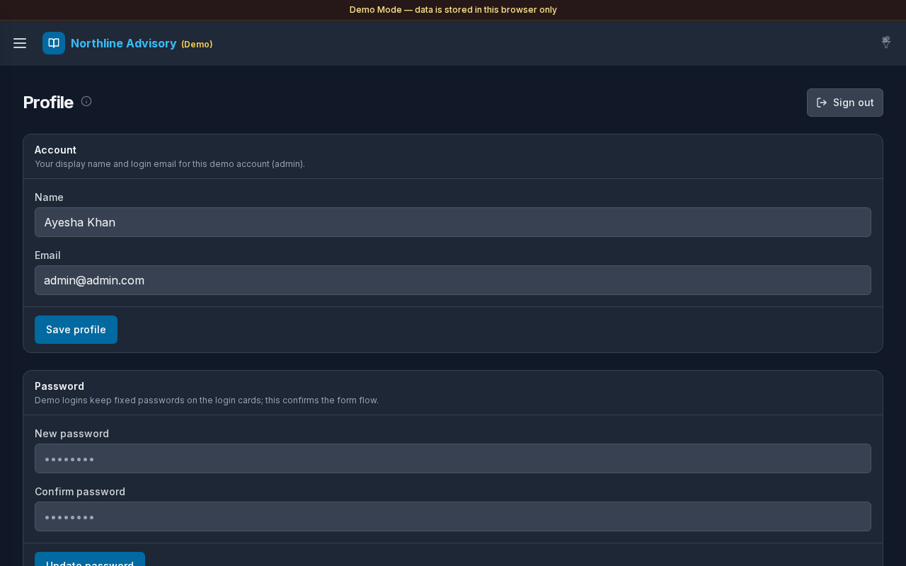

# Profile

**Version:** 1.0.0  
**Route:** `/settings/profile`  
**Who can access:** Signed-in users (own profile).

## Screenshot

## What this page does

Update your display name and email for the current Demo Mode session, confirm the password form flow, and **Sign out**.

## Layout at a glance

- Title **Profile** with info tip
- Header action: **Sign out**
- Section **Account**: **Name**, **Email**, **Save profile**
- Section **Password**: **New password**, **Confirm password**, update action

## Steps

### Update profile

1. Open **Settings** → **Profile**.
2. Edit **Name** and **Email**.
3. Select **Save profile**.
4. A success message confirms the demo session was updated.

### Change password (demo form)

1. Enter **New password** (at least 8 characters).
2. Re-enter under **Confirm password**.
3. Submit the password form.
4. In Demo Mode, fixed passwords on the login account cards remain the documented way to re-enter; the form confirms the UI flow for this session.

### Sign out

1. Select **Sign out** (button shows **Signing out…** while working).
2. You return to [Login](./01-login.md).

## Fields

| Field | Required | Notes |
|-------|----------|--------|
| Name | Yes | Display name for this demo user |
| Email | Yes | Login email for this session |
| New password | For password form | Minimum 8 characters |
| Confirm password | For password form | Must match new password |

## Errors & edge cases

- Empty name: **Name is required.**
- Empty email: **Email is required.**
- Short password: **Password must be at least 8 characters.**
- Mismatch: **New password and confirmation do not match.**
- Info tip: update display name for this demo session; sign out ends the local session.

## Related links

- [Login](./01-login.md)
- [Settings](./12-settings.md)
- [Mobile](./16-mobile.md)
