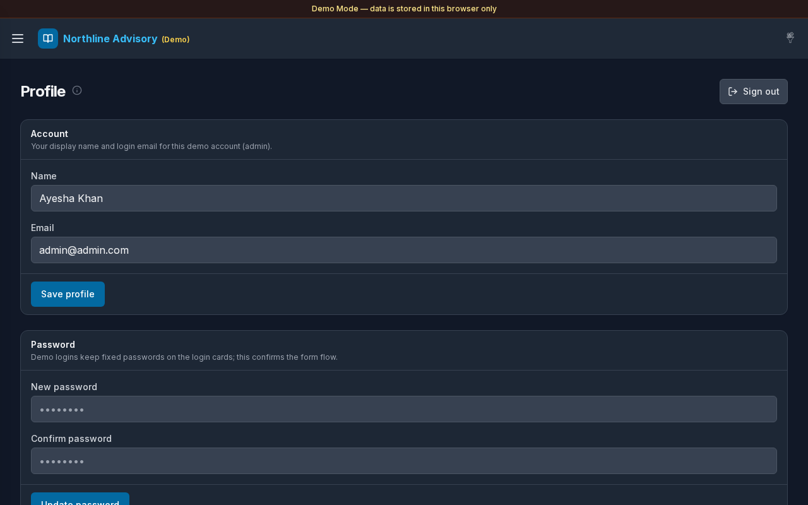

# Profile

**Version:** 1.7.0  
**Route:** `/settings/profile`  
**Who can access:** Signed-in users (own profile).

## Screenshot

## What this page does

Update your display name, change your password (current + new + confirm), and **Sign out**. Email is shown for reference and cannot be edited here.

## Layout at a glance

- Title **Profile** with info tip
- Header action: **Sign out**
- Section **Account**: **Name** (editable), **Email** (view-only), **Save profile**
- Section **Change password**: **Current password**, **New password**, **Confirm new password**, **Update password**

## Steps

### Update profile

1. Open **Settings** → **Profile**.
2. Edit **Name** as needed. **Email** is read-only.
3. Select **Save profile**.
4. A success message confirms the update.

### Change password

1. Enter **Current password**.
2. Enter **New password** (at least 8 characters) and **Confirm new password**.
3. Select **Update password**.
4. On success, you stay signed in; a confirmation message appears under the form.
5. In **Embedded Demo Mode** on the production app, password changes are disabled. In the portfolio **demo-mode** app, the form validates the fixed demo password for UI review only.

### Sign out

1. Select **Sign out** (button shows **Signing out…** while working).
2. You return to [Login](./01-login.md).

## Fields

| Field | Required | Notes |
|-------|----------|--------|
| Name | Yes | Display name |
| Email | — | View-only; matches the signed-in login email |
| Current password | For password form | Must match the existing account password |
| New password | For password form | Minimum 8 characters; must differ from current |
| Confirm new password | For password form | Must match new password |

## Errors & edge cases

- Empty name: **Name is required.**
- Missing current password: **Current password is required.**
- Wrong current password: **Current password is incorrect.**
- Short password: **Password must be at least 8 characters.**
- Mismatch: **New password and confirmation do not match.**
- Same as current: **New password must be different from your current password.**

## Related links

- [Login](./01-login.md)
- [Change password & Forgot / Reset](./23-password-reset.md)
- [Settings](./12-settings.md)
- [Mobile](./16-mobile.md)
