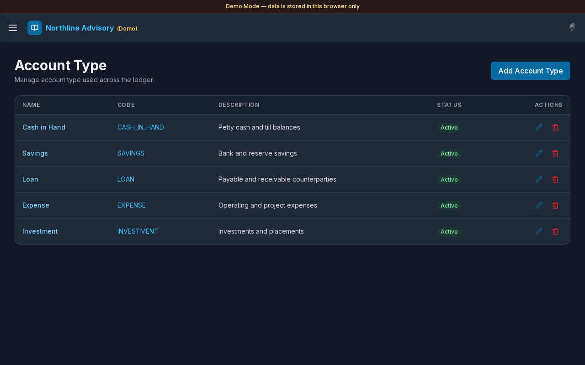

# Account Type

**Version:** 1.0.3  
**Route:** `/settings/account-type`  
**Who can access:** Signed-in users with permission to manage setup types (Admin in Demo Mode).

## Screenshot

## What this page does

Maintain the catalog of account types (for example Cash in Hand, Savings, Loan, Expense, Investment). Types drive account classification and Settings filters for Cash & Savings and Payable/Receivable.

## Layout at a glance

- Title **Account Type**
- **Add** control to create a type
- List of types with name, code, description, active state, and linked account counts
- Edit (pencil) and **Delete** actions
- Add / edit modal for type fields

## Steps

### Browse types

1. Open **Settings** → **Account Type**.
2. Review existing types used across accounts.

### Add an account type

1. Select **Add** (or the + control).
2. Enter **Name** and **Code** (required).
3. Optionally enter **Description**.
4. Set **Active** as needed.
5. Save the type.

### Edit a type

1. Select the edit (pencil) control on a row.
2. Update fields and save.

### Delete a type

1. Select **Delete** on a row.
2. Confirm the deletion dialog if prompted.
3. Prefer deactivating a type that is still in use when you need to keep history tidy.

### See accounts using a type

1. Where the UI shows an account count, open it to list accounts of that type.
2. Manage those accounts under [Accounts](./04-accounts.md).

## Fields

| Field | Required | Notes |
|-------|----------|--------|
| Name | Yes | Shown on account forms and lists |
| Code | Yes | Stored uppercase; used in CSV import matching |
| Description | No | Optional helper text |
| Active | — | Inactive types are hidden from new account pickers |

## Errors & edge cases

- Missing name or code: validation messages such as **Code is required.**
- Empty catalog: **No account types yet. Tap + to add one.**
- Expense and Investment pages look for type names **Expense** / **Expenses** and **Invest** / **Investment**.

## Related links

- [Cash Type](./15-settings-cash-type.md)
- [Accounts](./04-accounts.md)
- [Settings](./12-settings.md)
