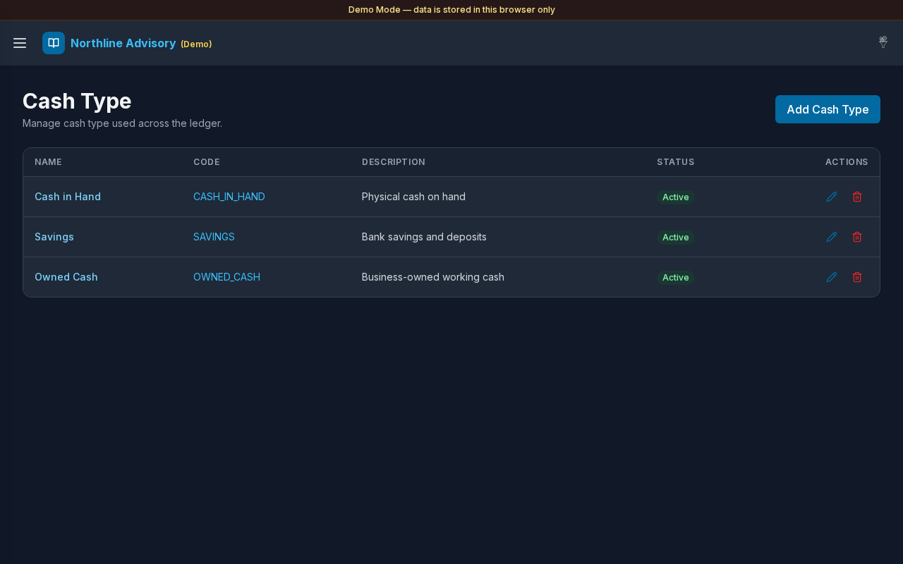

# Cash Type

**Version:** 1.2.3  
**Route:** `/settings/cash-type`  
**Linked accounts:** `/settings/cash-type/{id}`  
**Who can access:** Signed-in users with permission to manage setup types (Admin in Demo Mode).

## Screenshot

## What this page does

Maintain cash-type classifications (for example Cash in Hand, Savings, Owned Cash). Combined with Account Type in Settings, these filters control which accounts appear on Cash & Savings and Payable/Receivable.

## Layout at a glance

- Title **Cash Type** with info tip
- **Add** control
- Mobile: brand-sky type cards (same pattern as Account Type)
- Desktop table with name, code, description, accounts, status, actions
- Edit and **Delete** controls
- Same add/edit modal pattern as Account Type
- Tap a type to open its linked accounts page

## Steps

### Browse cash types

1. Open **Settings** → **Cash Type**.
2. Review types assigned to accounts.

### Add a cash type

1. Select **Add**.
2. Enter **Name** and **Code**.
3. Optionally add **Description** and set **Active**.
4. Save.

### Edit or delete

1. Use edit (pencil) to update a type.
2. Use **Delete** and confirm when the type is no longer needed.

### See accounts using a type

1. Tap a type card (or the name / account count on desktop).
2. The linked accounts page lists those accounts.
3. Tap an account to open filtered [Transactions](./03-transactions.md).
4. Use **Back** to return to Cash Type.

### Wire types into views

1. Open [Settings](./12-settings.md).
2. Assign cash types under **Cash & Savings** and **Payable & Receivable**.
3. Select **Save**.

## Fields

| Field | Required | Notes |
|-------|----------|--------|
| Name | Yes | Displayed on accounts |
| Code | Yes | Used for CSV matching |
| Description | No | Optional |
| Active | — | Inactive types drop out of new account pickers |

## Errors & edge cases

- Empty list: **No cash types yet. Tap + to add one.**
- Linked accounts empty: **No accounts use this cash type yet.**
- Validation for name/code mirrors Account Type.
- Accounts still keep historical type labels even if you later rename a type.

## Related links

- [Account Type](./14-settings-account-type.md)
- [Settings](./12-settings.md)
- [Cash & Savings](./05-cash-savings.md)
