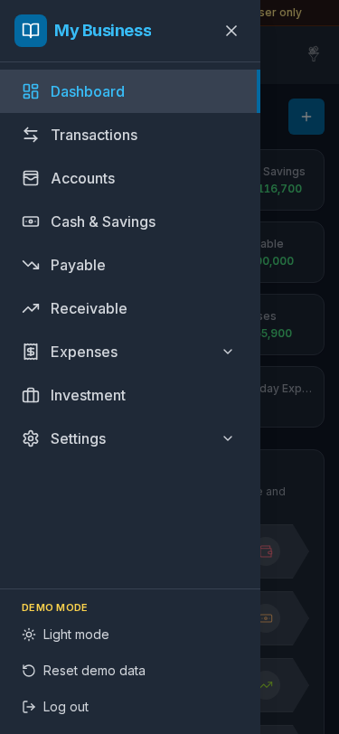
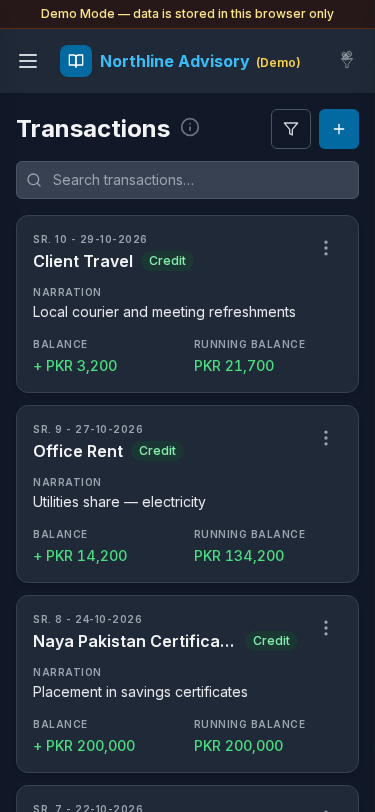
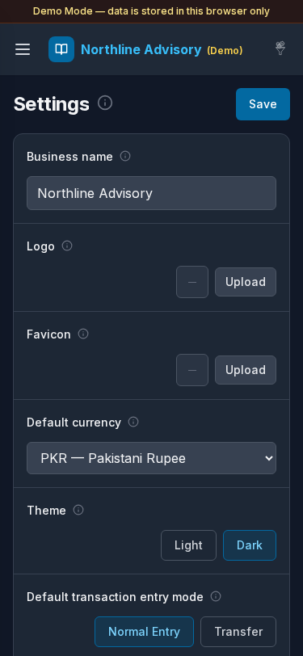

# Mobile

**Version:** 1.0.0  
**Routes:** `/`, `/transactions`, `/settings` (and the shared navigation shell)  
**Who can access:** Signed-in users on phone-sized viewports.

## Screenshots

## What this page does

Accounting Ledger is responsive. On phones, the sidebar becomes an off-canvas drawer, lists use compact cards where helpful, and primary actions stay reachable. This guide covers the mobile subset captured for documentation.

## Layout at a glance

- Top bar: menu (hamburger), business name, utility icons
- Demo banner when running Demo Mode
- Off-canvas nav with the same items as desktop: Dashboard, Transactions, Accounts, Cash & Savings, Payable, Receivable, Expenses (with Daily / Monthly), Investment, Settings
- Theme toggle and **Reset demo data** / sign-out options in the drawer footer where available

## Steps

### Open navigation

1. Tap the menu (hamburger) control in the top bar.
2. The drawer opens with the full app map ([see screenshot](./images/20-mobile-nav.png)).
3. Tap a destination, or close the drawer with the **X** / outside tap.

### Use the mobile dashboard

1. After login, the [Dashboard](./02-dashboard.md) shows KPI cards in a compact grid.
2. Tap **Add Transaction** (plus) to post without leaving the home screen.
3. Tap linked KPI cards to open detail pages.

### Work transactions on mobile

1. Open **Transactions**.
2. Use search and filters; tap **Add** to create an entry.
3. Row menus remain available for edit and delete.

### Adjust settings on mobile

1. Open **Settings** from the drawer.
2. Edit fields and tap **Save** — same labels as desktop General settings.
3. Use **Profile** in the Settings submenu for sign-out.

### Re-login on mobile (optional)

The login screen uses the same account cards as desktop. If you sign out, choose a Demo Mode account card again to return. A duplicate capture of the login screen exists for maintainers; mobile re-login matches the [Login](./01-login.md) guide.

## Errors & edge cases

- Narrow screens hide the persistent sidebar; always use the hamburger menu.
- Some tables switch to stacked cards — search still works the same.
- Demo data remains local to the browser; clearing mobile site data resets sandboxes.
- Landscape tablets may show desktop layouts; use portrait phone width for the screenshots above.

## Related links

- [Login](./01-login.md)
- [Dashboard](./02-dashboard.md)
- [Transactions](./03-transactions.md)
- [Settings](./12-settings.md)
