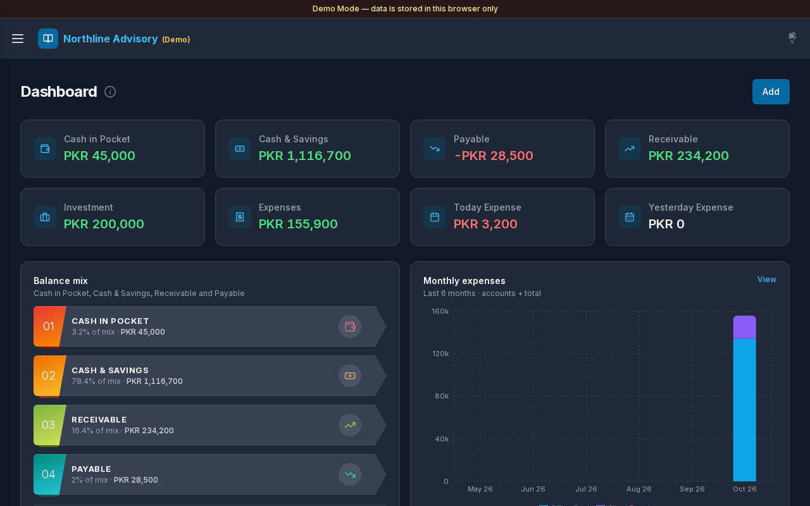
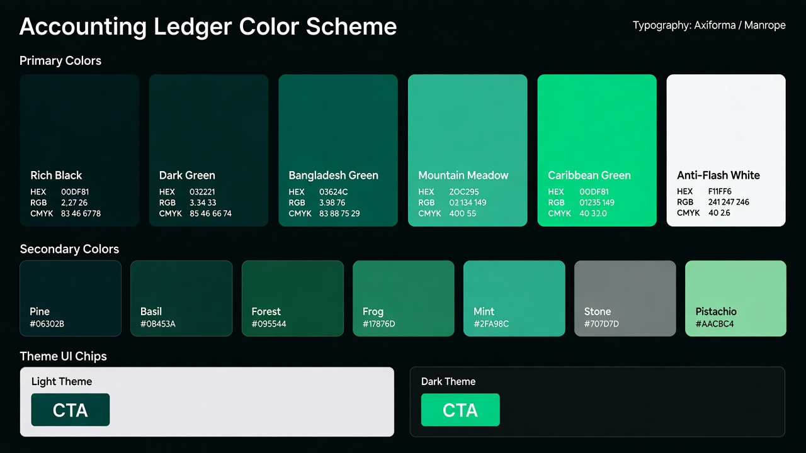

# Accounting Ledger

Accounting Ledger helps small businesses keep professional books: journals, account balances, cash and savings, payables and receivables, expenses, and investments — with clear dashboards and settings you can tailor to your workflow.





| | |
|---|---|
| **Version** | 1.6.1 |
| **Released** | 2026-11-24 |
| **Live app** | [cash.trendswd.com](https://cash.trendswd.com/) |
| **Live demo** | [accounting-ladger-system-coral.vercel.app](https://accounting-ladger-system-coral.vercel.app) |

## How to open the demo

1. Open the main app (or [live demo](https://accounting-ladger-system-coral.vercel.app)) and go to `/login`.
2. Click **Try Demo Mode** — no credentials required. Sample Northline Advisory data stays in your browser only.
3. Use **Exit Demo Mode** on the banner (or Sign out) to return to `/login`. Real sign-in / sign-up are unchanged.
4. Optional: the separate portfolio `demo-mode/` deploy still supports card-based demo logins (see `demo-mode/README.md`). Full steps: [18 — Embedded Demo Mode](./18-embedded-demo-mode.md).

## Documentation index

### Getting started

- [Getting started](./00-getting-started.md)
- [App version](./APP-VERSION.md)
- [Changelog](./CHANGELOG.md)

### Page guides

- [01 — Login](./01-login.md)
- [02 — Dashboard](./02-dashboard.md)
- [03 — Transactions](./03-transactions.md)
- [04 — Accounts](./04-accounts.md)
- [05 — Cash & Savings](./05-cash-savings.md)
- [06 — Payable](./06-payable.md)
- [07 — Receivable](./07-receivable.md)
- [08 — Expenses](./08-expenses.md)
- [09 — Daily Expense](./09-expenses-daily.md)
- [10 — Monthly Expense](./10-expenses-monthly.md)
- [11 — Investment](./11-investment.md)
- [12 — Settings (General)](./12-settings.md)
- [13 — Profile](./13-settings-profile.md)
- [14 — Account Type](./14-settings-account-type.md)
- [15 — Cash Type](./15-settings-cash-type.md)
- [16 — Mobile](./16-mobile.md)
- [17 — Android (Capacitor)](./17-android-capacitor.md)
- [18 — Embedded Demo Mode](./18-embedded-demo-mode.md)

### Policy & support

- [19 — Privacy Policy](./19-privacy-policy.md) *(Google Play Privacy Policy URL)*
- [20 — Terms & Conditions](./20-terms-and-conditions.md)
- [21 — Data & Account Deletion](./21-data-account-deletion.md)
- [22 — Support & Contact](./22-support-and-contact.md)

## App map

```text
Login
  └─ Dashboard
       ├─ Transactions (+ Add Transaction modal)
       ├─ Accounts
       ├─ Cash & Savings
       ├─ Payable
       ├─ Receivable
       ├─ Expenses
       │    ├─ Expenses (list)
       │    ├─ Daily Expense
       │    └─ Monthly Expense
       ├─ Investment
       └─ Settings
            ├─ General
            ├─ Profile
            ├─ Account Type
            └─ Cash Type
```
