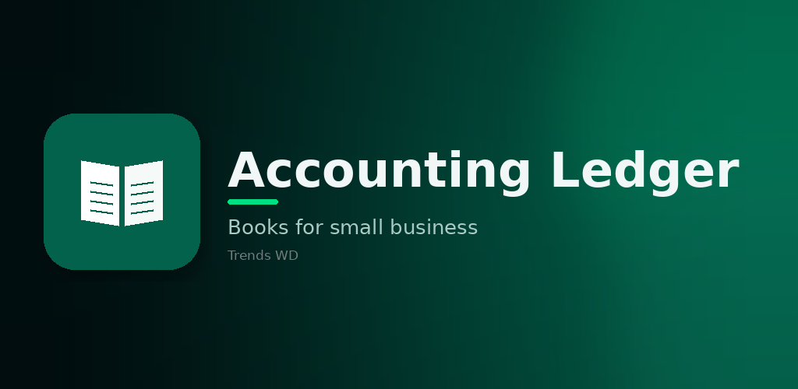
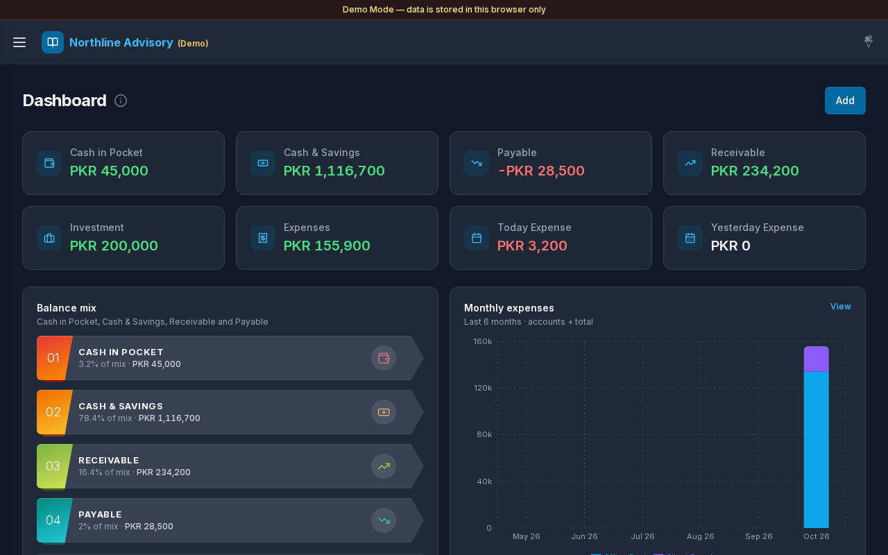
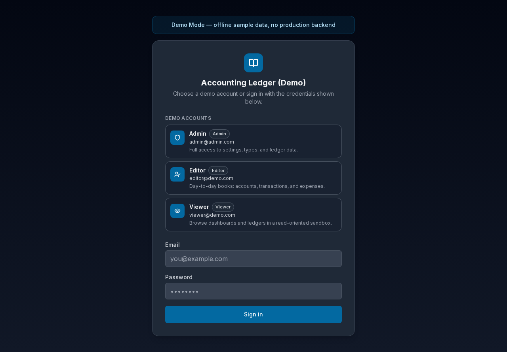
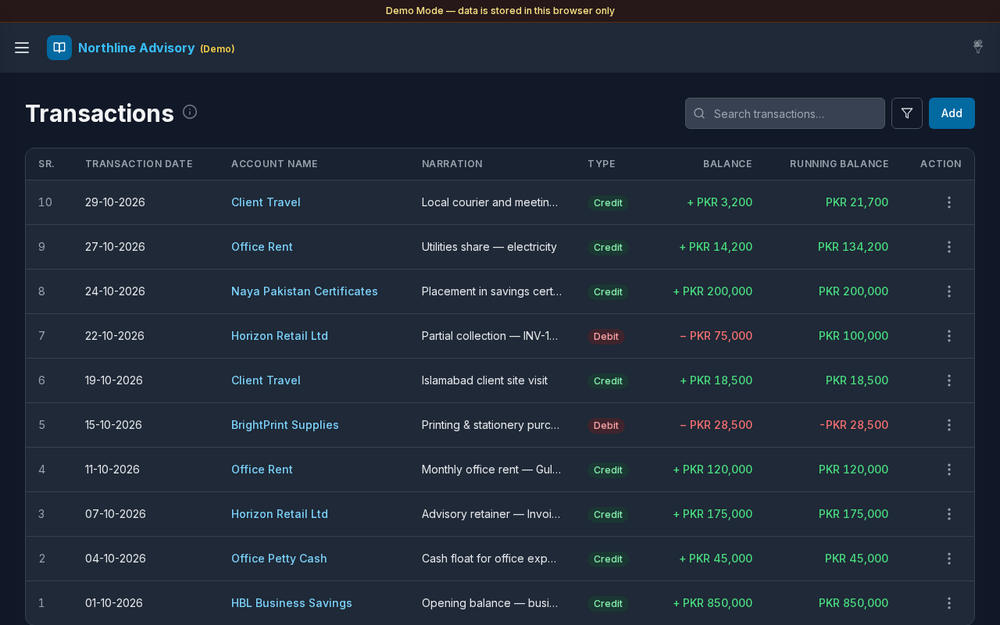
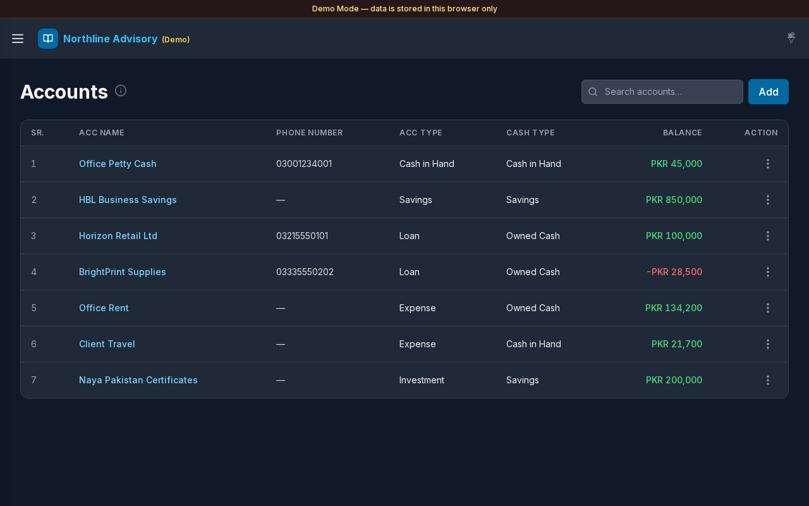
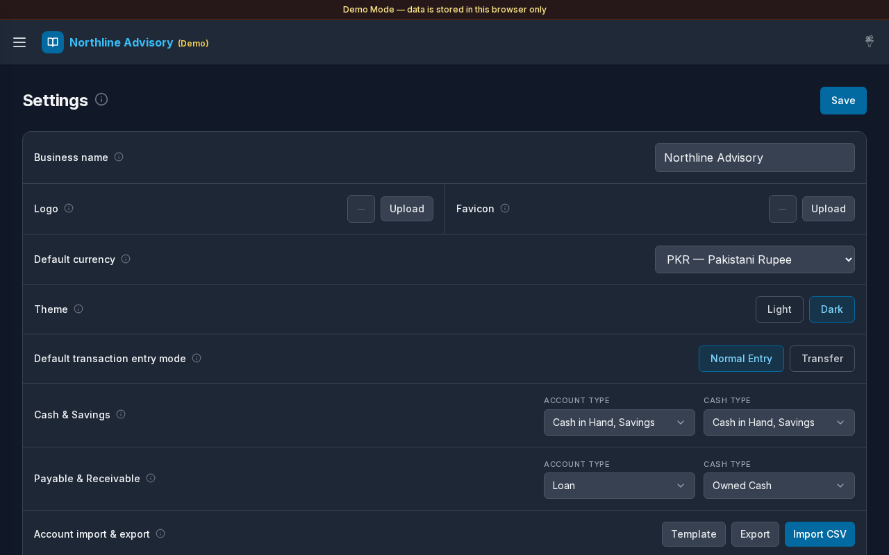
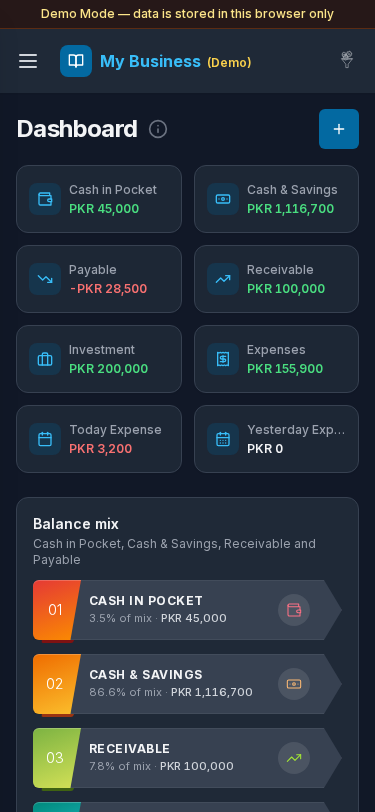

# Accounting Ledger



Day-to-day books for small businesses: accounts, journal entries, balances, expense analytics, exports, and shareable balance messages.

## Overview

Accounting Ledger is a web app for keeping professional ledgers without spreadsheets. Track cash and savings, payables and receivables, expenses, and investments from one dashboard. Sign-in protects every screen; **Try Demo Mode** on `/login` lets reviewers explore with sample data stored only in the browser.



## Features

- **Accounts & transactions** — ledgers with credit / debit / transfer entries, sort, filters, search, attachments, and Details / Documents previews
- **Dashboard** — balance cards, balance mix with day-over-day %, expense charts, and quick **Transactions** / **Add** actions
- **Cash & Savings / Payable / Receivable** — filtered balance views driven by your type settings
- **Expenses & investment** — dedicated lists plus daily and monthly expense grids
- **WhatsApp messages** — editable templates with optional voucher / ledger PDF links (`{{pdf_url}}`, `{{ledger_url}}`)
- **Settings** — branding, currency, theme, message templates, account types, and cash types
- **Exports** — ledger and transaction PDF / CSV
- **PWA** — installable on phone home screens
- **Android (Capacitor)** — native WebView app (`com.trendswd.cash`) loading the live site; see [`Documentation/17-android-capacitor.md`](Documentation/17-android-capacitor.md)

## Screenshots



*Login — sign in, create an account, or Try Demo Mode.*



*Journal with seeded Northline Advisory entries.*



*Chart of accounts with running balances.*



*General settings, branding, and filters.*



*Mobile dashboard (375×812).*

## Demo

- **Main app:** open `/login` → **Try Demo Mode** (no credentials). Sample ledger stays in `localStorage`; banner offers **Exit Demo Mode**. Guide: [`Documentation/18-embedded-demo-mode.md`](Documentation/18-embedded-demo-mode.md).
- **Portfolio Demo Mode app:** see [`demo-mode/README.md`](demo-mode/README.md)  
  ```bash
  cd demo-mode && npm install && npm run dev
  ```
- **Live portfolio demo:** [accounting-ladger-system-coral.vercel.app](https://accounting-ladger-system-coral.vercel.app) (separate Vercel project; Root Directory `demo-mode`; URL also in `demo-mode/demo.json` → `live_demo_url`).

## Documentation

Full client guides and screenshots: [`Documentation/index.md`](Documentation/index.md)

Canonical images: `Documentation/images/` (see `SCREENSHOT-INDEX.md`).

## Tech stack

| Layer | Stack |
|--------|--------|
| App | Next.js 14 · React 18 · TypeScript · Tailwind CSS |
| Android | Capacitor 8 (WebView → `https://cash.trendswd.com/`) |
| Auth & data (production) | Supabase |
| Files (production) | Cloudflare R2 (browser PUT via presign when CORS allows; `/api/uploads` fallback) |
| Charts / PDF | Recharts · jsPDF / pdf-lib |

## Getting started (production app)

```bash
cp .env.example .env.local
# fill Supabase + R2 values

# In your SQL editor, run:
# database/schema.sql

npm install
npm run dev
```

See [`.env.example`](.env.example) for variables. Optional: `JWT_SECRET`, `CRON_SECRET` (Vercel Cron hits `GET /api/cron` daily at 10:00 UTC).

For the fastest file uploads, allow your app origin in the R2 bucket CORS (PUT + GET). If CORS is missing, the app automatically falls back to same-origin `/api/uploads`.

**Note:** `demo-mode/` is excluded from the main product build. Deploy the demo as its own project.

## Version

**1.6.2** (2026-11-27) — see [`Documentation/APP-VERSION.md`](Documentation/APP-VERSION.md) and [`Documentation/CHANGELOG.md`](Documentation/CHANGELOG.md).

## License / contact

Trends WD portfolio product. Contact: [info@trendswd.com](mailto:info@trendswd.com) · [trendswd.com](https://www.trendswd.com/).

Policy docs (Privacy, Terms, deletion, support): [`Documentation/19-privacy-policy.md`](Documentation/19-privacy-policy.md) and related pages `20`–`22`.
