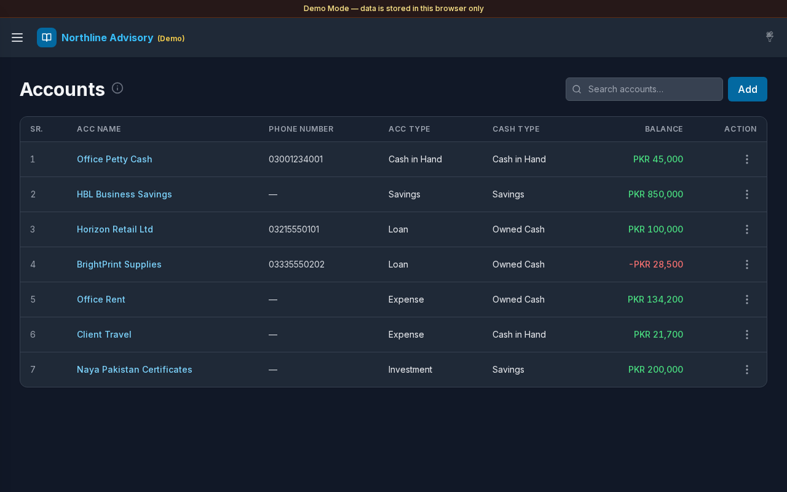
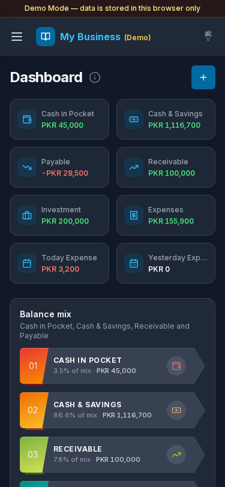

# Accounting Ledger

Day-to-day books for small businesses: accounts, journal entries, balances, expense analytics, exports, and shareable balance messages.


## Overview

Accounting Ledger is a web app for keeping professional ledgers without spreadsheets. Track cash and savings, payables and receivables, expenses, and investments from one dashboard. Sign-in protects every screen; Demo Mode lets you try the full UI offline with sample data.

## Features

- **Accounts & transactions** — ledgers with credit / debit / transfer entries, filters, search, and attachments
- **Dashboard** — balance cards, balance mix, daily and monthly expense charts
- **Cash & Savings / Payable / Receivable** — filtered balance views driven by your type settings
- **Expenses & investment** — dedicated lists plus daily and monthly expense grids
- **Settings** — branding, currency, theme, message templates, account types, and cash types
- **Exports** — ledger and transaction PDF / CSV
- **PWA** — installable on phone home screens

## Screenshots


*Demo Mode login — choose an account card to explore.*


*Journal with seeded Northline Advisory entries.*



*Chart of accounts with running balances.*


*General settings, branding, and filters.*



*Mobile dashboard (375×812).*

## Demo

- **Local Demo Mode:** see [`demo-mode/README.md`](demo-mode/README.md)  
  ```bash
  cd demo-mode && npm install && npm run dev
  ```
- **Live demo:** deploy pending — URL will be set in `demo-mode/demo.json` → `live_demo_url` when published (separate Vercel project; Root Directory `demo-mode`).
- Demo logins appear as **account cards** on the Demo Mode login screen (Admin, Editor, Viewer).

## Documentation

Full client guides and screenshots: [`Documentation/index.md`](Documentation/index.md)

Canonical images: `Documentation/images/` (see `SCREENSHOT-INDEX.md`).

## Tech stack

| Layer | Stack |
|--------|--------|
| App | Next.js 14 · React 18 · TypeScript · Tailwind CSS |
| Auth & data (production) | Supabase |
| Files (production) | Cloudflare R2 via `/api/uploads` |
| Charts / PDF | Recharts · jsPDF / pdf-lib |

## Getting started (production app)

```bash
cp .env.example .env.local
# fill Supabase + R2 values

# In your SQL editor, run:
# database/schema.sql

npm install
npm run dev
```

See [`.env.example`](.env.example) for variables. Optional: `JWT_SECRET`, `CRON_SECRET` (Vercel Cron hits `GET /api/cron` daily at 10:00 UTC).

**Note:** `demo-mode/` is excluded from the main product build. Deploy the demo as its own project.

## Version

**1.0.0** (2026-10-29) — see [`Documentation/APP-VERSION.md`](Documentation/APP-VERSION.md) and [`Documentation/CHANGELOG.md`](Documentation/CHANGELOG.md).

## License / contact

Trends WD portfolio product. Contact via [trendswd.com](https://www.trendswd.com/).
